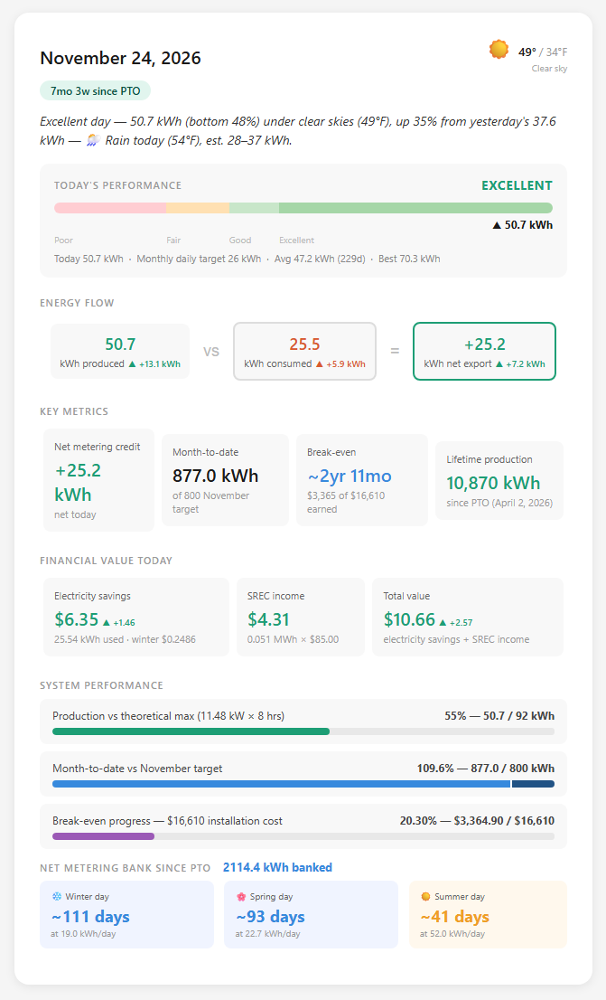
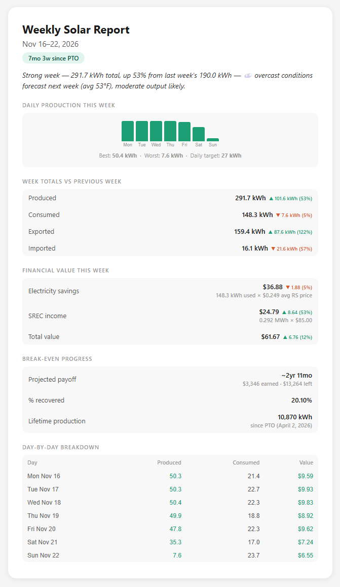
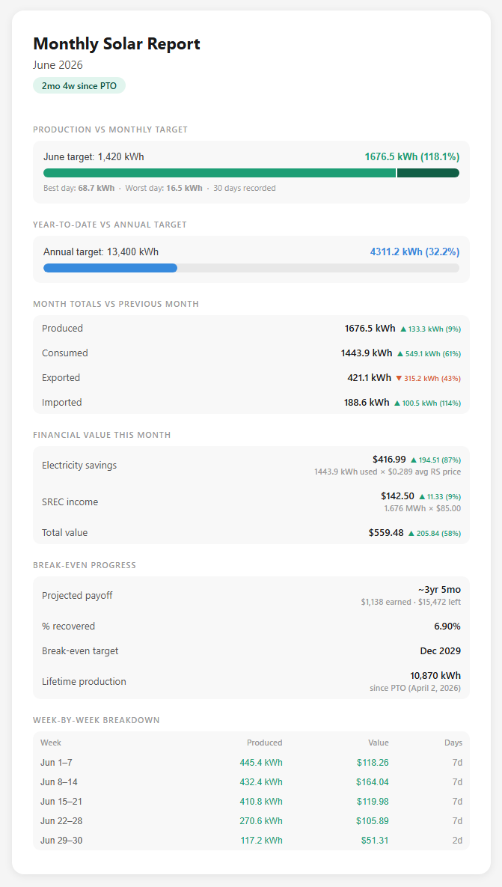

# Solar Report

A daily solar monitoring system for Enphase solar installations. Fetches production and consumption data from the Enphase Enlighten API v4, stores it in a local SQLite database, generates HTML reports, and sends a daily email digest via [Resend](https://resend.com).

---

## Features

### Daily Email Report
Sent every morning at 5am covering the previous day.



- **Headline summary** — punchy one-sentence digest: today's rating + all-time percentile + weather context + % change vs yesterday + tomorrow's forecast. Good days show "top X%"; below-average days show "bottom X%" (e.g. *"Tough day — 19.4 kWh (bottom 14%) under overcast skies (71°F), down 71% from yesterday's 67.0 kWh — 🌧️ Rain today (70°F), est. 35–47 kWh."*)
- **Weather** — daily high/low and conditions in the top-right corner (Open-Meteo, no key required)
- **Performance meter** — colour-banded gauge rating production as Poor / Fair / Good / Excellent vs. monthly daily target. The gauge runs to 135% of target and stretches on bigger days, so the needle never pins at the edge
- **Energy flow** — produced vs. consumed with net export/import
- **Change indicators** — every metric shows ▲/▼ vs. the previous day, colour-coded so "up" is always good (more consumption = red, more production = green)
- **Key metrics** — net metering credit, month-to-date production, break-even timeline, lifetime production since PTO
- **Financial value** — electricity savings (what the day's usage would have cost from PSE&G at Residential Service season/tier prices — while the net-metering bank has credit, all usage counts, not just the part covered same-day) plus SREC income
- **System performance bars** — percentages are uncapped; once a target is beaten the bar fills the track and the amount past 100% shows as a darker overflow segment after a white 100% marker
  - Production vs. theoretical max
  - Month-to-date vs. monthly target
  - Break-even progress
  - **Net metering bank** — cumulative kWh and dollar value banked since PTO, with days-of-coverage estimate. Calibrated to PSE&G's own cumulative net-metering figure from the latest bill, plus day-level Enphase data for everything after — Enphase's telemetry alone drifts from the utility's meter by a few percent over time

### Weekly Report
Sent every Monday at 6:00 AM covering the previous week.



- **Headline summary** — one-sentence digest with week-over-week comparison and next-week weather forecast
- Sparkline bar chart of daily production
- Week totals vs previous week with change indicators
- Financial value including SREC income
- Break-even progress and lifetime production since PTO
- Day-by-day breakdown table

### Monthly Report
Sent on the 1st of each month at 6:30 AM covering the previous month.



- Production vs monthly target progress bar (over-target months show the true % and a darker overflow segment past 100%)
- Year-to-date vs annual target
- Month totals vs previous month with change indicators
- Financial value including SREC income
- Break-even progress with projected payoff date and lifetime production since PTO
- Week-by-week breakdown table
- All periods clamped to PTO date — no pre-solar zeroes skew the data

### Break-Even Projection
- Year-by-year compound model with 3% annual electricity rate escalation
- Based on actual PSEG bill history (13 months of bills)
- Updates daily as real earnings accumulate

### GATS Monthly Reminder
Run manually or scheduled around the 2nd Saturday of the month, separate from the other reports.

- Computes Enphase's raw cumulative production as of the **last day of the previous month** (from the daily `/energy_lifetime` history) and emails it to you — GATS expects the literal cumulative reading, pre-interconnection production included, no offset. Month-end matches how GATS entries work (one generation month per entry, meter date inside that month's window) and reproduces the Jul/Aug 2026 readings you entered by hand exactly. Pass `YYYY-MM` to target a different month:
  - the exact number to paste into GATS's "Meter Reading (kWh)" entry, on its own line, no thousands separators
  - the generation month and the Meter Reading Date to enter (the month's last day)
  - a 6-month table of month-end readings and generated kWh (matches your GATS "Processed Generation" history; the PTO month counts from the day before PTO)
  - delta since your last submitted reading
  - estimated certificates this period and their dollar value at your `srec_rate` (counted above the 2,990 kWh initial meter reading registered in GATS, the same way GATS counts them)
  - running totals since April 2026
  - a direct link to your GATS entry page (`gats_entry_url` in `config.json`)
- Stateless: delta, certificates and running totals are derived from Enphase's month-end history, so re-running a month resends the same email
- **Fails loudly by email** instead of silently skipping a month if: the Enphase API errors or has no data for the month, the reading is negative, it decreased from the prior month-end, or it jumped more than 3,000 kWh since then

---

## Architecture

```
solar_report.py          ← daily orchestrator (fetch → save → report → email; failure alert on error)
├── enphase_api.py       ← Enphase Enlighten API v4 (OAuth2 + auto token refresh)
├── database.py          ← SQLite via sqlite3 (idempotent writes, totals as SQL SUMs)
│   └── rates.py         ← PSE&G Residential Service season/tier pricing for savings
├── report_builder.py    ← full HTML report (CSS layout, performance meter, payoff table)
├── email_builder.py     ← email-safe HTML (table layout, inline styles, weather widget)
└── send_email.py        ← Resend delivery: send_raw() for every report, send_failure_alert()

weekly_report.py         ← weekly summary report + email
monthly_report.py        ← monthly summary report + email
gats_reminder.py         ← monthly GATS meter-reading reminder (uses enphase_api + send_email)

common.py                ← shared config loading, PTO date, system size, monthly targets, rating scale
weather.py               ← Open-Meteo weather + forecast (cached per run)
tests/                   ← unittest suite (no network, temp DB and config)
```

If any scheduled job fails — Enphase hasn't published the day yet, an API error, a report bug — it emails a **🔴 … FAILED** alert with the error and traceback and exits non-zero, so a missed report is never silent. A day Enphase hasn't finished processing is never saved as 0 kWh.

---

## Setup

### Prerequisites
- Python 3.11+
- Enphase Enlighten developer account ([register here](https://developer-v4.enphase.com/))
- [Resend](https://resend.com) account (free tier: 100 emails/day)

### Install dependencies
```bash
pip install requests resend
```

### Configure
Copy `config.example.json` to `config.json` and fill in your values:

```bash
cp config.example.json config.json
```

| Key | Description |
|---|---|
| `client_id` / `client_secret` | Enphase OAuth2 app credentials |
| `api_key` | Enphase API key |
| `system_id` | Your Enphase system ID |
| `access_token` / `refresh_token` | OAuth2 tokens (auto-refreshed) |
| `pseg_rs_rates` | PSE&G Residential Service (RS) all-in $/kWh prices: `winter`, `summer_first_tier` (first 600 kWh/month), `summer_over_tier`, plus `tier_kwh`, `summer_months` (Jun–Sep) and `summer_consumption_share` (for break-even's blended rate). Each price = distribution + per-kWh riders + BGS + transmission from the rate sheet |
| `pseg_fixed_monthly` | Fixed monthly service charge (solar doesn't eliminate this) |
| `srec_rate` | SREC value in $/MWh (NJ: $85.00) — also used for GATS reminder $ estimates |
| `gats_entry_url` | PJM-EIS GATS generation entry page, linked in the monthly GATS reminder email |
| `net_cost` | Net system cost after incentives ($) |
| `annual_target_kwh` | Expected annual production from installer estimate |
| `annual_consumption_kwh` | Pre-solar annual consumption, used to cap break-even's electricity-savings estimate — pull this from actual PSE&G bill history (Usage → Bill by Year), not an installer estimate |
| `rate_escalation` | Assumed annual electricity-rate growth for break-even projections (e.g. `0.05` for 5%/yr) |
| `email_from` | Resend sender address |
| `email_to` | Recipient address |
| `resend_api_key` | Resend API key |
| `latitude` / `longitude` | Your location for weather data |

### Initialise the database
```bash
python database.py
```

### Run manually
```bash
# Yesterday's report (default)
python solar_report.py

# Specific date
python solar_report.py 2026-04-18

# Weekly report
python weekly_report.py

# Monthly report
python monthly_report.py

# GATS monthly reminder
python gats_reminder.py
```

### Run the tests
```bash
python -m unittest discover -s tests -t .
```
The suite uses only the standard library. It runs against a temporary database and a copy of `config.example.json`, makes no network calls, and never touches `solar.db` or `config.json`.

---

## Scheduled Tasks (Windows)

Three scheduled tasks run automatically; the GATS reminder is scheduled separately. To register them:

### Daily — 5:00 AM
```powershell
$action  = New-ScheduledTaskAction -Execute "python" -Argument "C:\dev\solar-report\solar_report.py" -WorkingDirectory "C:\dev\solar-report"
$trigger = New-ScheduledTaskTrigger -Daily -At "05:00"
Register-ScheduledTask -TaskName "SolarDailyReport" -Action $action -Trigger $trigger -RunLevel Highest
```

### Weekly — Monday 6:00 AM
```powershell
$action  = New-ScheduledTaskAction -Execute "python" -Argument "C:\dev\solar-report\weekly_report.py" -WorkingDirectory "C:\dev\solar-report"
$trigger = New-ScheduledTaskTrigger -Weekly -DaysOfWeek Monday -At "06:00"
Register-ScheduledTask -TaskName "SolarWeeklyReport" -Action $action -Trigger $trigger -RunLevel Highest
```

### Monthly — 1st of month, 6:30 AM
```powershell
schtasks /create /tn "SolarMonthlyReport" /tr "python C:\dev\solar-report\monthly_report.py" /sc monthly /d 1 /st 06:30 /rl highest /f
```

### GATS Reminder — 2nd Saturday of month
```powershell
schtasks /create /tn "SolarGatsReminder" /tr "C:\dev\solar-report\run_gats_reminder.bat" /sc monthly /mo second /d SAT /st 09:00 /rl highest /f
```

---

## Net Metering Bank Calibration

Enphase's day-level net drifts from PSE&G's meter by a few dozen kWh per quarter, so the bank is anchored to the bill. When a new bill arrives:
1. Open the bill's **Net Metering Program** table and take the latest row's meter-reading date and **Cumulative kWh**.
2. Set `BANK_ANCHOR_DATE` / `BANK_ANCHOR_KWH` in `database.py` to that date and the sign-flipped value (PSE&G's −1,904 → `1904.0`).
3. While you're there, compare each billing period's `OUT − IN` against `SUM(net)` in `daily_readings` for the same dates — a period that's off by much more than ~50 kWh usually means a missing day or a glitch reading.

To repair a single past day, run `python solar_report.py YYYY-MM-DD` (re-fetches, saves and re-sends that day's report) or call `database.save_reading(enphase_api.fetch_day("YYYY-MM-DD"))`. Saving a past day automatically recomputes the savings of every later day, since each day's value depends on the bank and month-to-date usage before it.

Last calibrated against the Nov 5, 2026 bill (cumulative −1,904 kWh).

## Electricity Rate Updates

You're on PSE&G **Residential Service (RS)** — not time-of-use — so price depends only on season (summer = June–September) and, in summer, whether you're past 600 kWh in the month. `rates.py` applies those prices; the numbers live in `pseg_rs_rates` in `config.json`.

When PSE&G publishes new rates (the "Understanding Your PSE&G Bill" insert, or pseg.com/tariffs):
1. For each of winter, summer 0–600 and summer over-600, add the RS **distribution** charge, every per-kWh rider (Conservation Incentive, Societal Benefits, Non-utility Generation, Solar Pilot, Green Programs, ZEC, Tax Adjustment Credit, COVID-19 — credits are negative), the **BGS** charge and the **transmission** charge.
2. Update `pseg_rs_rates` (and its `effective` date) in `config.json`.
3. Recompute savings for the affected rows:

```bash
python -c "import database; print(database.recompute_savings('2026-06-01'), 'rows updated')"
```

Calendar months stand in for billing months, so the 600 kWh summer tier boundary is approximate.

### Break-even model inputs

`annual_consumption_kwh` and `rate_escalation` (used by `report_builder._break_even`) aren't quarterly like the rate itself, but re-check them whenever you've accumulated another year of PSE&G bill history (Usage → Bill by Year in PSE&G's MyAccount, "Dollar ($)" and "Consumption (kWh)" views):
1. Sum each complete year's kWh and $ to get an actual annual consumption figure and an effective $/kWh — update `annual_consumption_kwh` if it's drifted from what's currently set.
2. Compare same-month effective rates year over year to estimate a real CAGR, and sanity-check `rate_escalation` against it plus any current NJ rate-outlook news (PJM capacity auction results, BPU announcements) rather than extrapolating a single spike/dip year.

---

## SREC Income

SRECs are NJ-approved and included in `total_value` (`database.py`) and in the break-even projection (`report_builder.py`). `srec_rate` in `config.json` is $/MWh.

If your SREC rate changes, update `srec_rate` in `config.json` and run `database.recompute_savings("<first affected date>")` — it recomputes `srec_earned`, `electricity_savings` and `total_value`.

---

## Database Schema

```sql
daily_readings (
    date                TEXT PRIMARY KEY,
    produced            REAL,   -- kWh from solar
    consumed            REAL,   -- kWh total home consumption
    imported            REAL,   -- kWh net import from grid (derived)
    exported            REAL,   -- kWh net export to grid (derived)
    net                 REAL,   -- produced - consumed
    self_consumed       REAL,
    srec_earned         REAL,   -- daily SREC accrual
    electricity_savings REAL,   -- usage valued at RS season/tier price (rates.py)
    total_value         REAL    -- electricity_savings + srec_earned
)
```

Month-to-date and lifetime production are `SUM(produced)` queries over `daily_readings`. The older `cumulative` counter table is no longer read or written; it's harmless if it still exists in an existing `solar.db`.

---

## Notes

- **Rate limiting** — Enphase free tier allows ~10 API calls/minute. The client includes exponential backoff. When backfilling multiple days, add a 30-second gap between runs.
- **Token refresh** — OAuth2 access tokens are refreshed automatically and saved back to `config.json`.
- **Import/export accuracy** — Gross daily import and export require 15-minute interval data. The system uses `net = produced − consumed` and displays produced vs. consumed directly. This matches Enphase's reported totals exactly.
- **PTO date** — Set to your Permission To Operate date in `common.py` (`PTO_DATE = "YYYY-MM-DD"`). All period calculations are clamped to this date.
